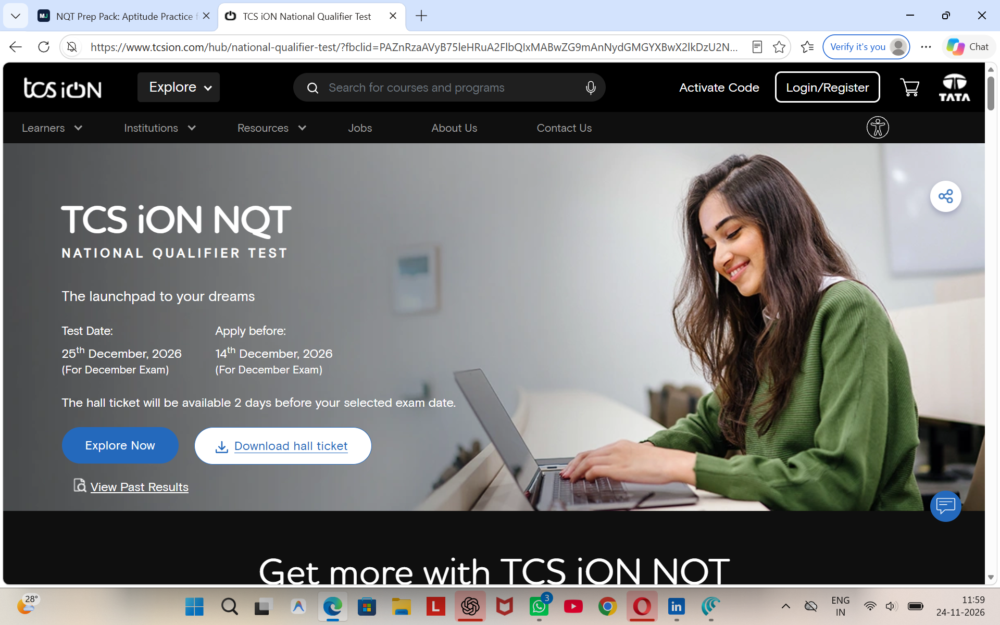
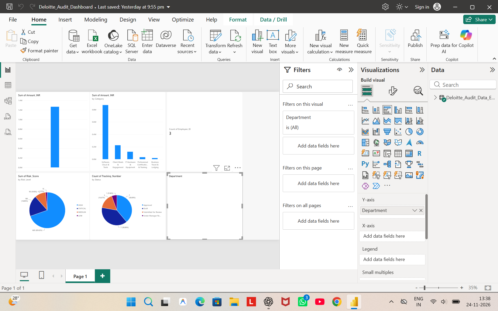
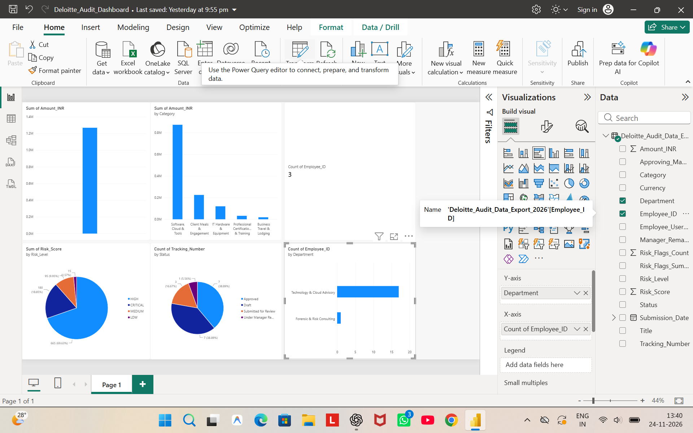

# Deloitte Audit Dashboard – Enterprise Risk & Governance Analytics
**Designed & Built by Shaik Karishma** | *Targeted for Deloitte 2027 NLA Analyst Trainee Recruitment*

[](https://powerbi.microsoft.com/)
[]()
[](https://www2.deloitte.com/)
[](https://www.djangoproject.com/)
[](https://aws.amazon.com/)

---

## 📌 Project Overview
The **Deloitte Audit Dashboard** is an enterprise-grade business intelligence and forensic reporting solution developed in **Power BI**. It consumes transaction feeds directly from the **AuditVault – Enterprise Cloud Audit & Risk Governance Engine**, transforming raw audit logs into actionable, executive-level insights.

In corporate professional services and consulting firms like **Deloitte**, managing thousands of expense claims, internal procurement requests, and compliance audits requires real-time anomaly detection and transparent financial oversight. This dashboard addresses that need by tracking submission velocities, identifying high-risk policy violations, and providing drill-down visibility across organizational cost centers.

---

## 📊 Dashboard Visual Tour

Here are views from the live Power BI dashboard:

### Executive Audit & Governance Overview


### Departmental & Tracking Trends


### Risk Exposure & Metric Summary


---

## 📑 5 Report Pages Breakdown

The report is structured across **5 dedicated pages**, each tailored to a specific governance and audit function:

### Page 1: Executive Overview & Categorical Distribution
* **Visuals:** Clustered Column Charts, Pie Charts, Clustered Bar Charts, and Metric Cards.
* **Objective:** Provides an executive summary of overall spending patterns across categories (*Software & Cloud, Client Entertainment, Hardware, Travel, Training*).
* **Key Finding:** *Software, Cloud & Tools* constitutes the largest single expenditure category (₹873.5K across 13 claims).

### Page 2: Submission Velocity & Tracking Timeline Trends
* **Visuals:** Dual Line Charts (`Tracking Number Trend By Submission Date`).
* **Objective:** Analyzes submission velocity over time to detect transaction clusters, weekend/out-of-office submission anomalies, and rapid-fire claim generation.
* **Key Finding:** Uncovered high submission velocity bursts where multiple claims were generated within 48-hour audit windows.

### Page 3: Key Financial & Compliance Metrics
* **Visuals:** Standalone KPI Card Visuals (`Total Amount(INR)`, `Total Tracking Records`, `Total Risk Flags`).
* **Objective:** High-visibility scorecard displaying critical balance metrics at a glance.
* **Key Finding:** ₹1,268,900.00 total expenditure tracked across 18 audited records with multiple automated policy flags.

### Page 4: Organizational Exposure & Employee Distribution
* **Visuals:** KPI Card Visuals (`Total Employees`, `Total Department`, `Total Risk Score`).
* **Objective:** Evaluates organizational spread and departmental risk concentrations.
* **Key Finding:** Highlights cross-department activity between *Technology & Cloud Advisory* and *Forensic & Risk Consulting*.

### Page 5: Risk Level & Forensic Governance Breakdown
* **Visuals:** Donut Chart (`Risk Level Distribution`).
* **Objective:** Categorizes all transactions into `LOW`, `MEDIUM`, `HIGH`, and `CRITICAL` risk tiers based on automated forensic rules.
* **Key Finding:** 13 out of 18 claims (72%) fall into High or Critical risk brackets, demanding managerial and auditor scrutiny.

---

## 📈 Verified Dataset Insights (Actual Data)

| Metric | Verified Value | Business & Audit Context |
| :--- | :--- | :--- |
| **Total Audit Claims** | **18 Claims** | Complete dataset exported from the live AuditVault application |
| **Total Gross Amount** | **₹1,268,900.00** | Net expenditure across all business units |
| **Approved Claims** | **7 Claims (₹516.9K)** | Fully vetted and cleared by managerial authority |
| **Pending Approvals** | **4 Claims (₹302.0K)** | Awaiting manager review or escalated for audit clearance |
| **Draft In-Progress** | **7 Claims (₹450.0K)** | Initial employee claims currently in draft state |
| **High & Critical Risk** | **13 Claims (₹1.07M)** | Claims triggering policy limits ($>\text{₹}50\text{K}$) or missing invoices |
| **Top Critical Claim** | **₹150,000.00** | *Executive Dining & Strategy Session* (Risk Score: 100/100) |

---

## 🧮 Key DAX Measures Implemented

```dax
// Total Expenditure Volume
Total Amount = SUM('Audit_Data'[Amount_INR])

// Approved Volume
Approved Claims = CALCULATE(COUNTROWS('Audit_Data'), 'Audit_Data'[Status] = "Approved")

// Pending Volume
Pending Claims = CALCULATE(COUNTROWS('Audit_Data'), 'Audit_Data'[Status] IN {"Submitted for Review", "Under Manager Review"})

// High & Critical Risk Claims
High Risk Claims = CALCULATE(COUNTROWS('Audit_Data'), 'Audit_Data'[Risk_Level] IN {"HIGH", "CRITICAL"})

// High Risk Exposure Rate
High Risk % = DIVIDE([High Risk Claims], COUNTROWS('Audit_Data'), 0)

// Average Forensic Risk Score
Avg Risk Score = ROUND(AVERAGE('Audit_Data'[Risk_Score]), 1)
```

*(Full measure formulas and descriptions are documented in [`docs/DAX_Measures.md`](docs/DAX_Measures.md)).*

---

## 🎨 Deloitte Brand Design Guidelines
* **Primary Palette:** Deloitte Green (`#86BC25`), Deep Slate (`#0F172A`), Slate Grey (`#334155`).
* **Status Signaling:** Approved (`#86BC25`), Pending Review (`#F59E0B`), Critical Risk / Rejection (`#E11D48`).
* **Typography:** Clean, high-legibility Segoe UI / Fluent styling with card drop-shadows.

---

## 📁 Repository Structure

```
Deloitte-Audit-Dashboard/
│
├── Deloitte_Audit_Dashboard.pbix     # Main Power BI Desktop Report (5 Pages)
│
├── data/
│   ├── Audit_Data_Export.xlsx        # Excel data source exported from AuditVault
│   └── Deloitte_Audit_Data_Export_20261123.csv # Relational CSV export
│
├── screenshots/
│   ├── dashboard_view_1.png          # Executive & category view
│   ├── dashboard_view_2.png          # Trend & tracking velocity view
│   └── dashboard_view_3.png          # Risk & KPI summary view
│
├── docs/
│   ├── DAX_Measures.md               # Detailed DAX formulas & logic
│   └── Data_Dictionary.md            # Column schema & business definitions
│
├── .gitignore                        # Git exclusion rules
└── README.md                         # Project documentation
```

---

## 🚀 How to Open and Explore the Report

1. **Prerequisite:** Install [Power BI Desktop](https://powerbi.microsoft.com/desktop/).
2. **Clone the repository:**
   ```bash
   git clone https://github.com/ShaikKarishma2026/Deloitte-Audit-Dashboard.git
   ```
3. Open `Deloitte_Audit_Dashboard.pbix` in Power BI Desktop.
4. Interact with the slicers and visuals across all 5 report pages!

---

## 👤 Author & Background
* **Developer:** Shaik Karishma
* **Target Role:** Analyst Trainee / Associate (Deloitte 2027 NLA)
* **Certifications:** Deloitte Technology Job Simulation (Forage), Deloitte Australia Data Analytics Simulation (Forage), AWS Solutions Architecture (Forage), Pluto Academy Java DSA.
* **LinkedIn:** [linkedin.com/in/Karishma2026](https://linkedin.com/in/Karishma2026)
* **GitHub:** [github.com/ShaikKarishma2026](https://github.com/ShaikKarishma2026)
