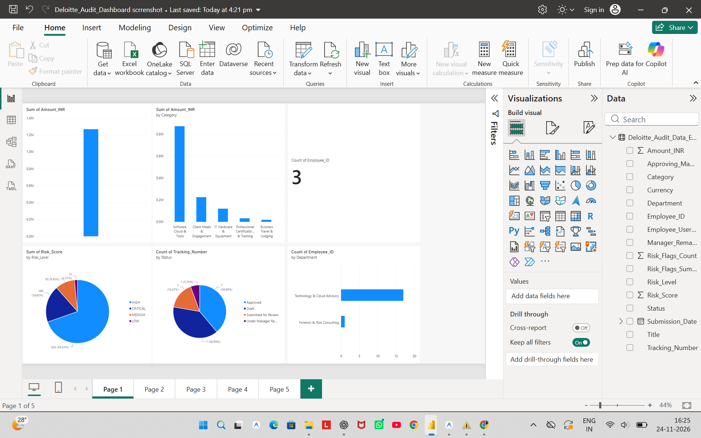
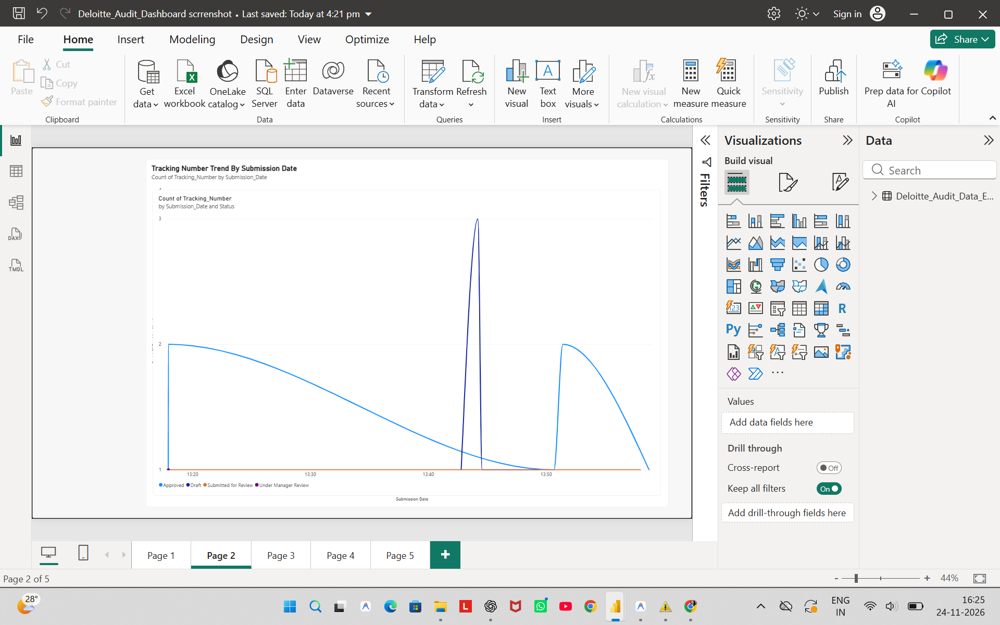
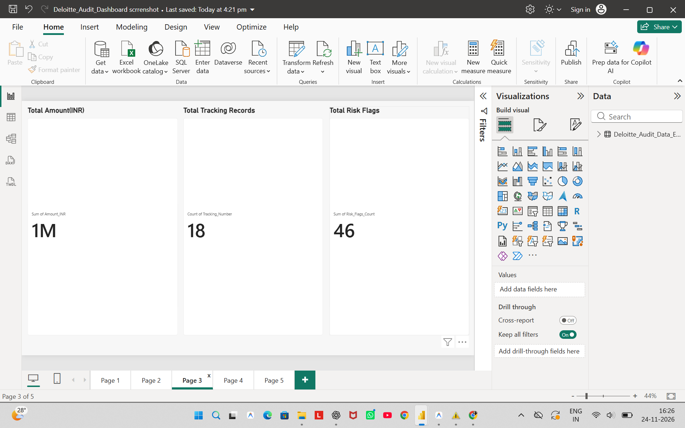
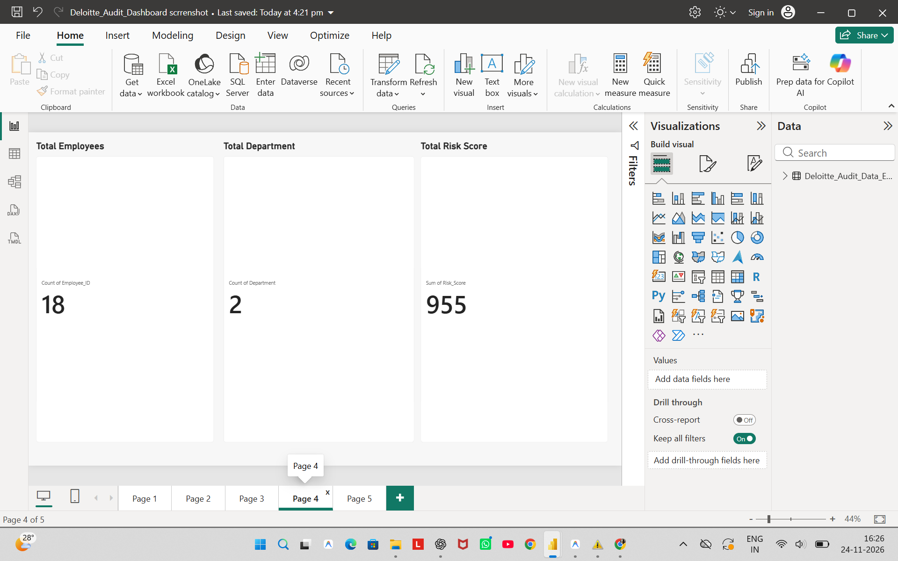
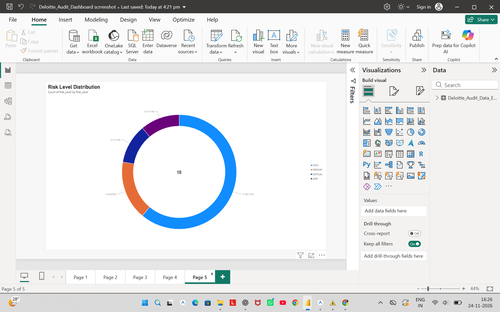

# Audit Risk & Compliance Dashboard – Enterprise Power BI Analytics
**Designed & Built by Shaik Karishma**

[](https://powerbi.microsoft.com/)
[]()
[]()
[]()
[](https://www.djangoproject.com/)
[]()

---

## 📌 Project Overview
The **Audit Risk & Compliance Dashboard** is an enterprise-grade business intelligence and forensic reporting solution developed in **Power BI**. It models and visualizes structured audit datasets exported from the **AuditVault – Enterprise Cloud Audit & Risk Governance Engine**, transforming recorded expense logs into actionable, executive-level insights.

In corporate consulting and professional services organizations, managing thousands of expense claims, internal procurement requests, and compliance audits requires systematic anomaly detection and transparent financial oversight. This dashboard addresses that need by tracking submission velocities, identifying high-risk policy violations, and providing drill-down visibility across organizational cost centers.

---

## 📊 Dashboard Visual Tour

Here are the views from the Power BI dashboard report:

### Page 1: Executive Audit & Categorical Distribution


### Page 2: Submission Velocity & Tracking Timeline Trends


### Page 3: Key Financial & Compliance Metrics


### Page 4: Organizational Exposure & Employee Distribution


### Page 5: Risk Level & Forensic Governance Breakdown


---

## 📑 5 Report Pages Breakdown

The report is structured across **5 dedicated pages**, each tailored to a specific governance and audit function:

### Page 1: Executive Overview & Categorical Distribution
* **Visuals:** Clustered Column Charts, Pie Charts, Clustered Bar Charts, and Metric Cards.
* **Objective:** Provides an executive summary of overall spending patterns across categories (*Software & Cloud, Client Entertainment, Hardware, Travel, Training*).
* **Key Finding:** *Software, Cloud & Tools* constitutes the largest single expenditure category (₹873,500.00 across 13 claims = 68.8% of total spend).

### Page 2: Submission Velocity & Tracking Timeline Trends
* **Visuals:** Dual Line Charts (`Tracking Number Trend By Submission Date`).
* **Objective:** Analyzes submission velocity over time to detect transaction clusters, weekend/out-of-office submission anomalies, and rapid-fire claim generation.
* **Key Finding:** Uncovered high submission velocity bursts where multiple claims were generated within 48-hour audit windows.

### Page 3: Key Financial & Compliance Metrics
* **Visuals:** Standalone KPI Card Visuals (`Total Amount(INR)`, `Total Tracking Records`, `Total Risk Flags`).
* **Objective:** High-visibility scorecard displaying critical balance metrics at a glance.
* **Key Finding:** ₹1,268,900.00 total expenditure tracked across 18 audited records with 46 automated policy flags.

### Page 4: Organizational Exposure & Employee Distribution
* **Visuals:** KPI Card Visuals (`Total Employees`, `Total Department`, `Total Risk Score`).
* **Objective:** Evaluates organizational spread and departmental risk concentrations.
* **Key Finding:** Highlights cross-department activity between *Technology & Cloud Advisory* (17 claims, ₹1.22M) and *Forensic & Risk Consulting* (1 claim, ₹50.0K).

### Page 5: Risk Level & Forensic Governance Breakdown
* **Visuals:** Donut Chart (`Risk Level Distribution`).
* **Objective:** Categorizes all transactions into `LOW`, `MEDIUM`, `HIGH`, and `CRITICAL` risk tiers based on automated forensic rules.
* **Key Finding:** 13 out of 18 claims (72.2%) fall into High or Critical risk brackets, demanding managerial and auditor scrutiny.

---

## 📈 Verified Dataset Insights (Audited Against Excel)

| Metric | Verified Value | Business & Audit Context |
| :--- | :--- | :--- |
| **Total Audit Claims** | **18 Claims** | Complete dataset exported from the AuditVault application |
| **Total Gross Amount** | **₹1,268,900.00** | Net expenditure across all business units |
| **Approved Claims** | **7 Claims (₹516,900.00)** | Fully vetted and cleared by managerial authority |
| **Pending Approvals** | **4 Claims (₹302,000.00)** | Awaiting review (3 Submitted for Review + 1 Under Manager Review) |
| **Draft In-Progress** | **7 Claims (₹450,000.00)** | Initial employee claims currently in draft state |
| **High & Critical Risk** | **13 Claims (₹1,070,000.00)** | 11 High Risk + 2 Critical Risk claims (72.2% of total claims) |
| **Total Risk Flags** | **46 Flags** | Cumulative automated forensic rules triggered across claims |
| **Total Risk Score** | **955 Points** | Cumulative forensic score across 18 transactions (Average: 53.1 / 100) |
| **Top Critical Claim** | **₹150,000.00** | *Executive Dining & Strategy Session* (Risk Score: 100/100) |
| **Top Spending Category** | **₹873,500.00** | *Software, Cloud & Tools* (13 claims, 68.8% of total expenditure) |

---

## 🧮 Key DAX Measures Implemented

```dax
// Total Expenditure Volume
Total Amount = SUM('Deloitte_Audit_Data_Export_2026'[Amount_INR])

// Approved Volume
Approved Claims = CALCULATE(COUNTROWS('Deloitte_Audit_Data_Export_2026'), 'Deloitte_Audit_Data_Export_2026'[Status] = "Approved")

// Pending Volume
Pending Claims = CALCULATE(COUNTROWS('Deloitte_Audit_Data_Export_2026'), 'Deloitte_Audit_Data_Export_2026'[Status] IN {"Submitted for Review", "Under Manager Review"})

// High & Critical Risk Claims
High Risk Claims = CALCULATE(COUNTROWS('Deloitte_Audit_Data_Export_2026'), 'Deloitte_Audit_Data_Export_2026'[Risk_Level] IN {"HIGH", "CRITICAL"})

// High Risk Exposure Rate
High Risk % = DIVIDE([High Risk Claims], COUNTROWS('Deloitte_Audit_Data_Export_2026'), 0)

// Average Forensic Risk Score
Avg Risk Score = ROUND(AVERAGE('Deloitte_Audit_Data_Export_2026'[Risk_Score]), 1)
```

*(Full measure formulas and descriptions are documented in [`docs/DAX_Measures.md`](docs/DAX_Measures.md)).*

---

## 🎨 Enterprise Design & Palette Guidelines
* **Primary Palette:** Emerald Green (`#86BC25`), Deep Slate (`#0F172A`), Slate Grey (`#334155`).
* **Status Signaling:** Approved (`#86BC25`), Pending Review (`#F59E0B`), Critical Risk / Rejection (`#E11D48`).
* **Typography:** Clean, high-legibility Segoe UI / Fluent styling with card drop-shadows.

---

## 📁 Repository Structure

```
Deloitte-Audit-Dashboard/
│
├── Deloitte_Audit_Dashboard.pbix     # Main Power BI Desktop Report (5 Pages)
│
├── data/
│   ├── Audit_Data_Export.xlsx        # Excel data source exported from AuditVault
│   └── Deloitte_Audit_Data_Export_20261123.csv # Relational CSV export
│
├── screenshots/
│   ├── page_1_overview.png               # Page 1: Executive & categorical distribution
│   ├── page_2_tracking_trends.png        # Page 2: Submission velocity & tracking timeline
│   ├── page_3_financial_metrics.png      # Page 3: Key financial & compliance metrics
│   ├── page_4_organizational_metrics.png # Page 4: Organizational exposure & employee distribution
│   └── page_5_risk_distribution.png      # Page 5: Risk level & forensic governance breakdown
│
├── docs/
│   ├── DAX_Measures.md               # Detailed DAX formulas & logic
│   └── Data_Dictionary.md            # Column schema & business definitions
│
├── .gitignore                        # Git exclusion rules
└── README.md                         # Project documentation
```

---

## 🚀 How to Open and Explore the Report

1. **Prerequisite:** Install [Power BI Desktop](https://powerbi.microsoft.com/desktop/).
2. **Clone the repository:**
   ```bash
   git clone https://github.com/ShaikKarishma2026/Deloitte-Audit-Dashboard.git
   ```
3. Open `Deloitte_Audit_Dashboard.pbix` in Power BI Desktop.
4. Interact with the slicers and visuals across all 5 report pages!

---

## 👤 Author
* **Developer:** Shaik Karishma
* **Role:** Data Analyst / Power BI Developer
* **LinkedIn:** [linkedin.com/in/Karishma2026](https://linkedin.com/in/Karishma2026)
* **GitHub:** [github.com/ShaikKarishma2026](https://github.com/ShaikKarishma2026)
